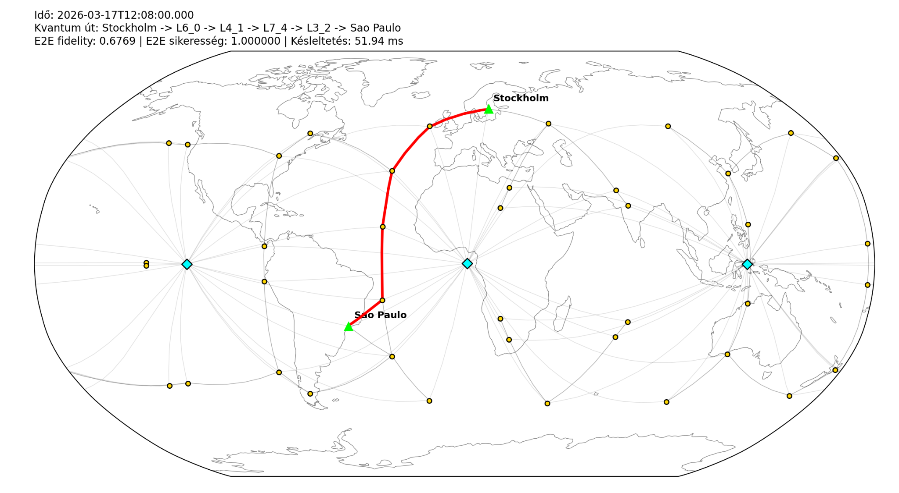

# Satellite Quantum Communication Network Simulation

A simulation of a satellite-based quantum communication network developed as a university project at the Budapest University of Technology and Economics (BME).

The project combines orbital simulation with dynamic network routing and an abstract quantum communication model. Satellite positions are propagated using Orekit, while the network topology is rebuilt over time based on satellite visibility and communication distance.

## Visualization

The visualization shows the dynamically changing satellite network and the selected communication route between Stockholm and São Paulo. LEO satellites are shown as yellow circles, GEO satellites as cyan diamonds, and the selected route is highlighted in red.

## Features

- Walker-delta LEO satellite constellation
- Optional GEO satellite layer
- Satellite orbit propagation using Orekit
- Dynamic line-of-sight based network topology
- Ground station to satellite communication links
- Network routing using NetworkX
- Distance-dependent channel loss model
- Parallel quantum channel model
- Link and end-to-end fidelity calculation
- Entanglement purification (EPP) strategies
- End-to-end success probability estimation
- Propagation, processing and EPP latency calculation
- Real-time world map visualization
- Optional simulation statistics and CSV export

## Simulation Model

The satellite constellation is propagated over time using Orekit. At every simulation step, the network topology is reconstructed based on the current satellite positions, line-of-sight constraints and maximum communication distances.

Each communication link is assigned quantum-network metrics including:

- transmission probability
- success probability
- fidelity
- distance
- EPP usage

Routing is performed using a weighted graph. Link weights are calculated as:

`weight = -log(p_success)`

This allows shortest-path routing to select a route with high end-to-end success probability.

The simulation also supports several entanglement purification strategies, including link-level and end-to-end adaptive approaches.

> The quantum communication layer uses an abstract mathematical model and is intended for network-level simulation rather than physical quantum-state simulation.

## Default Scenario

The current configuration simulates:

- 8 orbital planes
- 5 LEO satellites per plane
- 1200 km LEO altitude
- 53° inclination
- 3 optional GEO satellites
- Stockholm and São Paulo as ground stations
- 2 hours of simulated time
- 60-second simulation steps

Most simulation parameters can be changed at the top of `main.py`.

## Project Structure

    .
    ├── main.py
    ├── network_sim.py
    ├── orekit_manager.py
    ├── stats_manager.py
    ├── environment.yml
    └── screenshots/
        └── simulation.png

### `main.py`

Configures and runs the simulation, dynamically builds the network topology and handles visualization.

### `orekit_manager.py`

Handles orbit creation, Walker-delta constellation generation, coordinate transformations and line-of-sight calculations using Orekit.

### `network_sim.py`

Implements the network graph, quantum link model, entanglement purification, routing and end-to-end metric calculations.

### `stats_manager.py`

Collects simulation results and provides CSV export, summary statistics and plots.

## Environment

The project was developed and tested with:

- Python 3.11
- Orekit 13.1
- OpenJDK 8
- NetworkX
- Matplotlib
- Cartopy
- Pandas

A Conda environment definition is provided in `environment.yml`.

Create the environment with:

    conda env create -f environment.yml
    conda activate satellite-quantum-network

## Orekit Data

Orekit requires an external data archive for time scales and reference frame calculations.

Place the Orekit data archive in the project root as:

    orekit-data.zip

The archive is intentionally not included in this repository.

## Running

After activating the Conda environment and adding `orekit-data.zip` to the project root:

    python main.py

Simulation parameters such as constellation size, channel count, EPP mode, simulation duration and visualization can be configured at the top of `main.py`.

## Technologies

- Python
- Orekit
- NetworkX
- Matplotlib
- Cartopy
- Pandas
- Conda